  

  
  

---

Frontend Developer aus Deutschland. Im Agentur-Alltag baue ich Headless-Frontends für Kunden – meistens **Nuxt + TypeScript** vor einem CMS oder Shop. Nebenbei: Side-Projects, Self-Hosting und Fotografie (Landschaft & Street).

  

  

Grad nix, shit :( Zumindest nicht für euch :)
